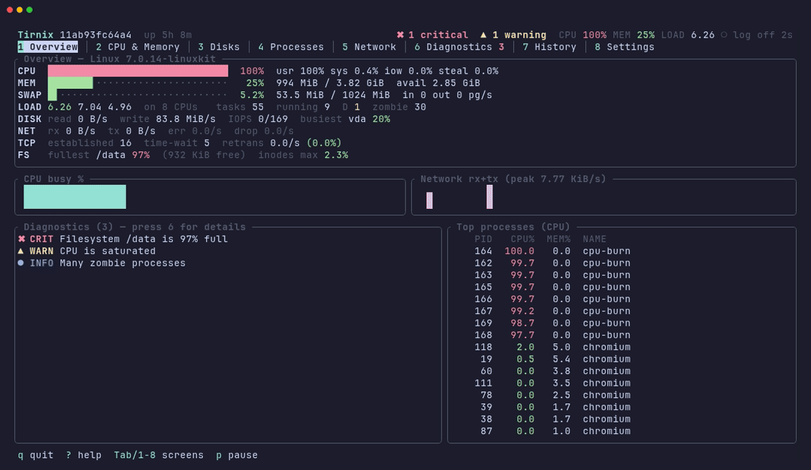

<p align="center">
  
</p>

<p align="center">
  <b>A lightweight terminal UI for monitoring and diagnosing Linux systems.</b><br>
  It shows what is happening, explains what it likely means, and tells you how to check.
</p>

<p align="center">
  <a href="https://github.com/Gelluithor/Tirnix/actions/workflows/ci.yml"></a>
  
  
</p>

<p align="center">
  
</p>

<p align="center"><sub>Recorded in a Linux container with a synthetic workload (CPU burners, a 97 % full tmpfs and 30 zombie processes); see <a href="docs/demo">docs/demo</a>.</sub></p>

---

## Why Tirnix

`htop` tells you that the CPU is at 100 %. Tirnix also tells you that it
*stayed* there for the last 30 seconds, which processes are responsible,
what usually causes it, and which commands confirm it – while keeping
measured facts and guesses apart.

- **One screen for the essentials.** CPU, memory, swap, load, disk and
  network throughput, TCP, the fullest filesystem, active findings and top
  processes – all on the Overview, even at 80×24. The header shows the key
  numbers on every screen.
- **Diagnostics instead of just numbers.** Each finding lists what was
  *measured*, *possible causes* (explicitly hypotheses) and *how to
  verify*. Rate-based rules need a sustained condition, so a single spike
  does not raise an alarm.
- **Honest data.** Everything comes from `/proc`, `/sys` and `statvfs`. A
  missing source is shown as `n/a`, never estimated.
- **Low overhead.** A single ~1.5 MB static binary. No daemon, database,
  telemetry or network traffic unless you ask for it.
- **Optional long-term history.** A small logger process, controlled from
  the TUI, stores selected metrics with retention and a size limit. History
  can be charted and compared with the previous period.
- **Made for servers.** Works over SSH, in small terminals, without root,
  with ASCII fallback for non-UTF-8 locales and `NO_COLOR` support.

## Contents

- [Installation](#installation) · [Updating](#updating) · [Uninstalling](#uninstalling)
- [Usage](#usage) · [Screens and keys](#screens-and-keys)
- [Long-term logging](#long-term-logging) · [Configuration](#configuration)
- [Resource usage](#resource-usage) · [Permissions](#permissions) · [Supported systems](#supported-systems)
- [Troubleshooting](#troubleshooting) · [Building from source](#building-from-source)
- More: [metrics and their limits](docs/METRICS.md) · [diagnostic rules](docs/DIAGNOSTICS.md) · [architecture](docs/ARCHITECTURE.md)

## Installation

Prebuilt binaries are fully static (musl) and run on any Linux distribution
on **x86_64** and **aarch64**. Nothing else needs to be installed: no
runtime, database, container engine or service.

### Install script (no root needed)

```sh
curl -fsSL https://raw.githubusercontent.com/Gelluithor/Tirnix/main/install.sh | sh
```

The script downloads the latest release for your architecture, **verifies
it against the release's `SHA256SUMS`**, and installs a single file,
`~/.local/bin/tirnix`. It does not touch anything else – no configuration,
no service, no background process.

If you prefer to read the script first (recommended):

```sh
curl -fsSLO https://raw.githubusercontent.com/Gelluithor/Tirnix/main/install.sh
less install.sh
sh install.sh                    # into ~/.local/bin
sh install.sh --version 0.1.0    # a specific release
sudo sh install.sh --system      # into /usr/local/bin for all users
sh install.sh --dir ~/bin        # any directory
```

If `~/.local/bin` is not on your `PATH`, the script tells you how to add it.

### Debian / Ubuntu (.deb) and Fedora / RHEL / openSUSE (.rpm)

Download the package for your architecture from the
[releases page](https://github.com/Gelluithor/Tirnix/releases), then:

```sh
sudo apt install ./tirnix_0.1.0-1_amd64.deb      # Debian, Ubuntu
sudo dnf install ./tirnix-0.1.0-1.x86_64.rpm     # Fedora, RHEL, Rocky, Alma
```

Packages install `/usr/bin/tirnix`, documentation and the optional systemd
unit files. **No service is enabled or started.**

### Manual install

```sh
curl -fsSLO https://github.com/Gelluithor/Tirnix/releases/latest/download/tirnix-x86_64-unknown-linux-musl.tar.gz
curl -fsSLO https://github.com/Gelluithor/Tirnix/releases/latest/download/SHA256SUMS
sha256sum --check --ignore-missing SHA256SUMS
tar xzf tirnix-x86_64-unknown-linux-musl.tar.gz
install -m 755 tirnix-x86_64-unknown-linux-musl/tirnix ~/.local/bin/
```

## Updating

Run the install script again (same options as before). It replaces the
binary atomically and keeps your configuration and history. Packages update
with `apt`/`dnf` as usual.

If background logging is running, restart it so it uses the new binary:

```sh
tirnix logger stop && tirnix logger start          # logger started from the TUI/CLI
sudo systemctl restart tirnix-logger.service       # system service
```

Changes are listed in [CHANGELOG.md](CHANGELOG.md).

## Uninstalling

```sh
sh uninstall.sh              # stops your logger, removes ~/.local/bin/tirnix
sh uninstall.sh --system     # binary in /usr/local/bin
sh uninstall.sh --purge      # also delete ~/.config/tirnix and ~/.local/state/tirnix
```

(`uninstall.sh` is in the repository and in every release archive.)
Without `--purge`, configuration and stored history are kept and their
location is printed. Packages: `sudo apt remove tirnix` / `sudo dnf remove tirnix`.
If you enabled a systemd unit, disable it first (see below).

## Usage

```sh
tirnix                          # interactive TUI
tirnix report                   # sample for 5 s, print a summary and findings
tirnix report --seconds 30      # longer sample: sustained rules can fire
tirnix logger status            # is long-term logging running? how much is stored?
tirnix logger start | stop      # enable and start / stop and disable logging
tirnix export --since 24h --format csv -o last-day.csv
tirnix export --from 2026-10-01 --to 2026-10-02    # UTC dates or Unix seconds
tirnix config show              # effective configuration
tirnix --help
```

`tirnix report` is handy in scripts and quick SSH checks:

```text
CPU      100% busy (user 100%, system 0.0%, iowait 0.0%, steal 0.0%)
Load     3.45 1.27 0.52
Memory   823 MiB used of 3.82 GiB (3.02 GiB available)
…
[WARN] Filesystem /data is 94% full
  measured: 9.44 MiB used, 572 KiB available of 10.0 MiB (tmpfs on tmpfs).
  possible cause: Growing log files or journals.
  …
  verify: du -xh --max-depth=2 /data 2>/dev/null | sort -h | tail -20
```

## Screens and keys

| Key | Screen | What you get |
|---|---|---|
| `1` | **Overview** | CPU/memory/swap bars, load and tasks, disk and network totals, TCP, fullest filesystem, sparklines, findings, top processes |
| `2` | **CPU & Memory** | CPU time split, per-core usage, context switches, PSI, detailed memory and swap, major faults, OOM kills, file handles |
| `3` | **Disks** | Per-device throughput, IOPS, await, utilisation; filesystems with space and inode usage |
| `4` | **Processes** | Sortable process list with CPU, memory, threads, disk I/O and full command line; filter |
| `5` | **Network** | Interfaces with RX/TX, packets, errors, drops; TCP connections, retransmissions, listen drops, sockets |
| `6` | **Diagnostics** | Findings with measured facts, hypotheses and verification commands; data source coverage; active checks |
| `7` | **History** | Chart of any metric for the session or stored ranges (1 h … 30 days), comparison with the previous period |
| `8` | **Settings** | Refresh interval, logging on/off, interval, metrics, directory, retention, size limit, active check targets |

Global keys: `Tab`/`Shift-Tab` or `←`/`→` switch screens, `1`–`8` jump,
`p` pauses, `+`/`-` change the refresh rate, `?` shows all keys, `q` quits.
The footer always lists the keys of the current screen.

Processes: `↑`/`↓`, `PgUp`/`PgDn` select, `s` cycles the sort (CPU, memory,
I/O, PID, name), `/` filters by name, PID or user. Diagnostics: `↑`/`↓`
select a finding, `a` runs active checks. History: `←`/`→` range, `↑`/`↓`
metric, `c` compare.

## Long-term logging

Logging is **off** after installation and on first start. When you enable
it, Tirnix starts a separate, detached process (`tirnix logger run`) that
keeps sampling after you close the TUI or log out of SSH.

- **Turn it on/off:** Settings (`8`) → *Background logging* → `Enter`, or
  `tirnix logger start` / `tirnix logger stop`. Turning it off stops the
  process.
- **Choose what is stored:** metric groups `cpu`, `memory`, `disk`,
  `network`, `tcp`, `filesystem`, `pressure`.
- **Interval:** 1, 5, 10, 30 or 60 s (default 10 s).
- **Directory:** default `~/.local/state/tirnix` (`$XDG_STATE_HOME/tirnix`).
- **Retention and size limit:** files older than *N* days are deleted
  (default 7) and the oldest files go first when the total exceeds the
  limit (default 100 MiB).
- **Status** is visible in the TUI header (`● LOG`), on the Settings
  screen and with `tirnix logger status` (pid, files, size, last write).
- **One instance per directory:** the logger holds an exclusive lock;
  a second one refuses to start.
- **Live changes:** the logger notices config changes made in Settings
  within one interval.

Data are hourly [JSON Lines](https://jsonlines.org/) files
(`metrics-YYYYMMDD-HH.jsonl`, UTC), one record per sample. With all groups
selected a record is about 560 bytes, i.e. roughly 4.6 MiB per day at the
default 10 s interval. Use `tirnix export` for CSV/JSONL extracts, or read
the files directly with `jq`.

### Running the logger with systemd (optional)

For a logger that starts at boot, use one of the unit files in
[`contrib/systemd`](contrib/systemd) (packages install them under
`/usr/lib/systemd/`). They are never enabled automatically.

*System-wide*, sandboxed, running as a transient unprivileged user and
storing data in `/var/lib/tirnix`:

```sh
sudo install -Dm644 contrib/config/system-config.toml /etc/tirnix/config.toml
sudo install -m644 contrib/systemd/tirnix-logger.service /etc/systemd/system/   # not needed with packages
sudo systemctl daemon-reload
sudo systemctl enable --now tirnix-logger.service
sudo tirnix --config /etc/tirnix/config.toml       # view its history
sudo systemctl disable --now tirnix-logger.service # stop and disable
```

The unit is hardened (no network sockets, read-only system, no capabilities,
dynamic user, memory limit); `systemd-analyze security` rates it 1.1
("OK"). It points to `/usr/bin/tirnix`; if you installed to
`/usr/local/bin`, adjust `ExecStart` with `sudo systemctl edit
tirnix-logger.service`. To remove the data: `sudo rm -r /var/lib/private/tirnix`.

*Per user* (no root): copy `contrib/systemd/tirnix-logger-user.service` to
`~/.config/systemd/user/tirnix-logger.service`, set `enabled = true` in your
config, then `systemctl --user enable --now tirnix-logger.service`. Use
either this unit or the TUI toggle, not both.

## Configuration

The file is `~/.config/tirnix/config.toml` (`$XDG_CONFIG_HOME`, or
`$TIRNIX_CONFIG`, or `--config PATH`). It does not exist until you change
something in Settings; until then defaults are used. Settings writes a
commented file that you can also edit by hand:

```toml
[ui]
refresh_ms = 2000                 # TUI sampling interval

[collection]
include_network_fs = false        # NFS/CIFS/FUSE (statvfs can hang on dead servers)

[logging]
enabled = false
interval_secs = 10
directory = ""                    # empty = ~/.local/state/tirnix
retention_days = 7
max_size_mb = 100
metrics = ["cpu", "memory", "disk", "network", "tcp", "filesystem", "pressure"]

[active_checks]
targets = []                      # e.g. ["example.com:443", "10.0.0.1:22"]
timeout_ms = 2000
```

**Active checks** are the only feature that sends network traffic: when you
press `a` on the Diagnostics screen, Tirnix resolves each target and opens
one TCP connection to it. Passive monitoring never does.

## Resource usage

Measured on Linux 7.0 (aarch64, 8 CPUs) in a container with about 300
processes, over 60 s each:

| Mode | CPU (% of one core) | Memory (RSS) |
|---|---|---|
| TUI, Overview, 2 s refresh | 0.6 % | 2.1 MiB |
| TUI, Processes (incl. per-process I/O), 2 s refresh | 0.8 % | 2.2 MiB |
| Logger, 10 s interval | 0.05 % | 1.5 MiB |
| Logger, 1 s interval | 0.23 % | 1.5 MiB |

How it stays light: a reused read buffer for `/proc` files, process
scanning only in the TUI (never in the logger), per-process I/O only while
the Processes screen is open, command lines read only for visible rows,
filesystem sizes refreshed every 5 s, device and interface metadata cached
for a minute, no busy polling (the TUI sleeps until the next sample or key
press), and buffered writes in the logger.

## Permissions

Tirnix runs as a normal user. Root is only needed to see disk I/O of
*other users'* processes (`/proc/<pid>/io`); those cells show `n/a`
otherwise. On systems with `hidepid=2` only your own processes are listed.
Details of every value and its source: [docs/METRICS.md](docs/METRICS.md).

## Supported systems

- **Linux only** (it reads `/proc` and `/sys`). Kernel 4.20+ recommended:
  pressure stall information needs 4.20 with PSI enabled, the OOM kill
  counter 4.13; older kernels work with those values shown as `n/a`.
- **Architectures:** x86_64 and aarch64 (static binaries). Others can build
  from source.
- **Distributions:** any – the binary has no runtime dependencies. Tested in
  containers on Debian 12, Ubuntu 24.04, Fedora 42 and Alpine 3.22.
- Inside containers Tirnix shows the container's view (its processes,
  network namespace) together with host-wide CPU, memory and disk counters,
  as the kernel exposes them.

## Troubleshooting

| Problem | What to do |
|---|---|
| `tirnix: command not found` after installing | `~/.local/bin` is not on `PATH`: `export PATH="$HOME/.local/bin:$PATH"` (add it to `~/.profile`). |
| Boxes, question marks or broken lines | The terminal or locale is not UTF-8. Use a UTF-8 locale (`LANG=C.UTF-8`) or force ASCII with `TIRNIX_ASCII=1`. |
| No colours / too many colours | Colours follow the terminal palette; `NO_COLOR=1` disables them. |
| "Terminal too small" | Needs at least 30×8; 80×24 or larger is recommended. |
| PSI shows `n/a` | Kernel older than 4.20 or PSI disabled; on some distributions add `psi=1` to the kernel command line. |
| Process I/O shows `n/a` | Only root can read other users' `/proc/<pid>/io`. Run with `sudo` if you need it. |
| A network mount is missing on the Disks screen | Network/FUSE filesystems are off by default; enable them in Settings. |
| History is empty | Long-term logging is off (Settings → Background logging), the metric group is not selected, or the range is older than the retention. |
| Logger does not start | See `~/.local/state/tirnix/logger.log` and `tirnix logger status`. "another logger is already running" means one is active for that directory (maybe the systemd unit). |
| `logger stop` says it cannot signal the process | The logger runs as another user (e.g. the system service); use `systemctl`. |
| The installer reports a checksum mismatch | The download was corrupted or modified; nothing was installed. Try again; report it if it persists. |

## Building from source

Requires Rust 1.88 or newer.

```sh
git clone https://github.com/Gelluithor/Tirnix && cd Tirnix
cargo build --release                       # target/release/tirnix
cargo test && cargo clippy --all-targets -- -D warnings && cargo fmt --check

# Static binary as in releases:
rustup target add x86_64-unknown-linux-musl
cargo build --release --target x86_64-unknown-linux-musl
```

Releases are built by [GitHub Actions](.github/workflows/release.yml) when a
`v*` tag is pushed: static binaries, `.deb`, `.rpm` and `SHA256SUMS`. The
demo GIF can be re-recorded with [`docs/demo/record.sh`](docs/demo).

Contributions are welcome – please run the checks above before opening a
pull request. The code layout is described in
[docs/ARCHITECTURE.md](docs/ARCHITECTURE.md).

## License

Licensed under either of [MIT](LICENSE-MIT) or [Apache-2.0](LICENSE-APACHE)
at your option.
